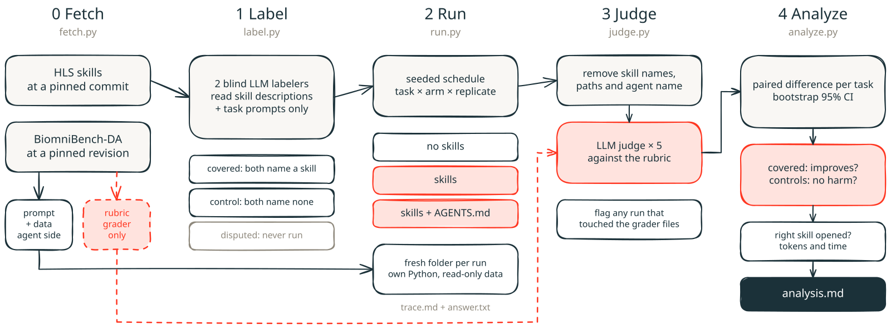

# Test skills against BiomniBench-DA

[BiomniBench-DA](https://huggingface.co/datasets/phylobio/BiomniBench-DA) is a public benchmark of open-ended
biomedical data analyses. In each task, the agent gets data and a question, writes its analysis to `trace.md` and its
result to `answer.txt`, and an LLM judge grades both against the task's expert-written rubric. This folder runs
[Genie Code CLI](https://docs.databricks.com/aws/en/genie-code/genie-code-cli) on those tasks with and without the
skills in this repository and compares the scores.



## How it works

1. **Fetch** the tasks at a pinned dataset revision. Data the agent may see and the rubric only the judge sees go to
   separate folders, so no run can read the answer key.
2. **Label** which tasks each skill covers. Two different LLMs read only each task's prompt and each skill's
   `description`, never the rubric, the data or a score. A task is **covered** when both name a shared skill,
   **control** when both name none, and **disputed** otherwise. Disputed tasks are never run.
3. **Run** every task in every arm, several times, in a seeded order. Each run gets a fresh folder with its own
   Python, the task's data, and, in skills arms, the skills at a pinned commit.
4. **Judge** each answer 5 times against its rubric, after removing skill names, skill paths and the agent's name,
   so the judge cannot tell the arms apart.
5. **Analyze** the paired score differences per task: does the skills arm do better on covered tasks, and no worse
   on controls? Also how often the right skill was opened, and the token cost.

## Prerequisites

- [Genie Code CLI](https://docs.databricks.com/aws/en/genie-code/genie-code-cli#install-and-set-up). Run `genie`
  once and finish onboarding to a Databricks CLI profile.
- [uv](https://docs.astral.sh/uv/). Each script declares its own dependencies.
- Access to the gated dataset on Hugging Face, and a token in `HF_TOKEN`. Fine-grained tokens need the "public gated
  repos" permission.
- A Databricks CLI profile whose workspace serves `databricks-gemini-3-8-flash` and `databricks-claude-sonnet-5-5`
  (Foundation Model APIs). The labelers and the judge use them.
- About 10 GB of free disk per task. Runs do not start below 8 GB free.

`OSB_HOME` (default `~/osb`) holds data, runs, grades and analyses. `OSB_GRADING` (default `~/.cache/osb-grading`)
holds prompts and rubrics, away from every run folder.

## Test one skill

Run from this folder. Arms are `no_skills` or `NAME=GIT_REF[:INSTRUCTIONS]`. `instructions/D0.md` is a one-line
`AGENTS.md` that tells the agent to read the matching skill before writing analysis code; it got Genie Code to open
the right skill on every covered task.

```bash
export HF_TOKEN=...
# 1. Fetch the tasks this skill covers, plus 6 controls for the no-harm check
uv run fetch.py --skill bulk-rnaseq --controls 6
# 2. Run both arms, 3 replicates each
uv run run.py --run-id bulk --skill bulk-rnaseq --controls 6 \
  --arm no_skills --arm skills=main:D0 --reps 3 --jobs 2
# 3. Grade, 5 judge repeats per answer
uv run judge.py --run-id bulk --out bulk --profile <profile>
# 4. Compare
uv run analyze.py --grades bulk --out bulk --a skills --b no_skills --skill bulk-rnaseq
```

The report goes to `$OSB_HOME/analysis/<out>/analysis.md`. It has three comparisons:

| Comparison | Tasks | Rule |
|---|---|---|
| Improves | covered | effect ≥ +5 points, 95% CI low end above −5, no task down more than 15 |
| No harm | control | effect above −5, no task down more than 15 |
| All | covered + control | descriptive |

It also shows each task's scores, the share of runs that opened an expected skill (covered) or any skill (controls),
and the median tokens and time per arm.

To compare two versions of a skill, use two refs, for example `--arm old=main:D0 --arm new=my-branch:D0`.

## Label new tasks or new skills

`tasks.json` holds the frozen labels and the skills commit they were made at. When a skill's description changes, or
to add tasks, relabel before running:

```bash
uv run fetch.py da-12-2 da-20-3                       # tasks not in tasks.json yet
uv run label.py da-12-2 da-20-3 --skills-ref main --name new --profile <profile>
uv run label.py --labeled --skills-ref main --name main --profile <profile> --write   # relabel all, update tasks.json
```

With `--write`, relabeling every task replaces the labels in `tasks.json`. Labeling only some tasks updates or adds
those rows and records the run under `labels.updates`, so the other labels stay frozen.

Each labeler's answers and reasons go to `labels/<name>_labeler_{a,b}.json`, and the endpoints, skills commit and
prompt hash go to `labels/<name>_meta.json`. Read the disputed tasks and the reasons before you commit.

The labels in `tasks.json` were made by two blind labelers at skills commit `576d170`. Rerunning `label.py` at that
commit gives the same label on 24 of 25 tasks. The exception is da-4-1, NMF on per-patient immune-cell proportions,
which both LLM labelers call a control because the data is a table, not an `h5ad` file.

## Reproducibility

Each run's `run.json` and each batch's `schedule-*.json` record what is needed to repeat it:

| What | Where it is pinned |
|---|---|
| Dataset | `HF_REVISION` in `fetch.py`, copied to each task's `hf_revision.txt` |
| Skills | each arm's ref resolved to a commit SHA and skills tree hash before the first run |
| Instruction file | its SHA-256 |
| Task labels | `tasks.json` `labels.skills_sha`, labeler endpoints and prompt hash |
| Run order | `--seed`; the schedule is written before the first run |
| Agent | Genie Code CLI version and model |
| Harness | this repository's commit |
| Judge | endpoint, repeats and prompt hash in `grades/<out>/meta.json` |
| Statistics | bootstrap seed, margin and drop thresholds in `analyze.py` |

Agent runs cannot be seeded, so repeat each (task, arm) at least 3 times. Write down the arms, tasks and thresholds
before the first run, and keep every run in the analysis.

## Guardrails

- **No answer key in reach.** Rubrics stay in `OSB_GRADING`. `judge.py` flags any run whose events mention the
  grading folder, and `analyze.py` leaves those runs out and lists them.
- **No leakage between arms.** Genie runs with the profile `biomnibench`, which turns off your personal skills and
  memories. Genie's bundled Databricks skills stay on in every arm, as they ship with the product. Skills are
  installed without their `eval/` and `tests/` folders.
- **Data as plain files.** Each run gets the task's files as read-only hard links, which cost no disk.
- **Infrastructure failures are not scores.** A run still rate-limited after all retries is left out of the
  analysis and listed. A lost connection or an IP ACL block is moved to `infra-failed/`, and rerunning the same
  command reruns it. A timeout or a missing answer is the agent's failure and scores 0.
- **Resumable runs and grading.** Rerunning the same `run.py` command keeps the skills commits pinned the first time,
  skips finished runs and retries runs that were still rate-limited. `judge.py` grades only finished runs, caches
  each grade per judge, and stops with an error if any finished run is left ungraded.
- **Your own skills stay out.** `run.py` stops if one of your personal skills has the same name as an HLS skill,
  because turning it off by name would turn off the HLS skill too.

## Limits

- Few public tasks fall within a skill's scope: about 10% of the BiomniBench-DA tasks we labeled. With a handful of
  covered tasks, only large effects can be detected.
- The judge reads the agent's trace, and an LLM judge is not a domain expert. For a second opinion, grade again with
  `--judge claude_sonnet_5_5` or `--judge-endpoint` into a new `--out`, and compare arms only within one judge.
- Agents can read the whole disk. Run each study in its own `OSB_HOME`.

## Tests

```bash
uv run --isolated --with pytest --with pyyaml python -m pytest -q tests
```
